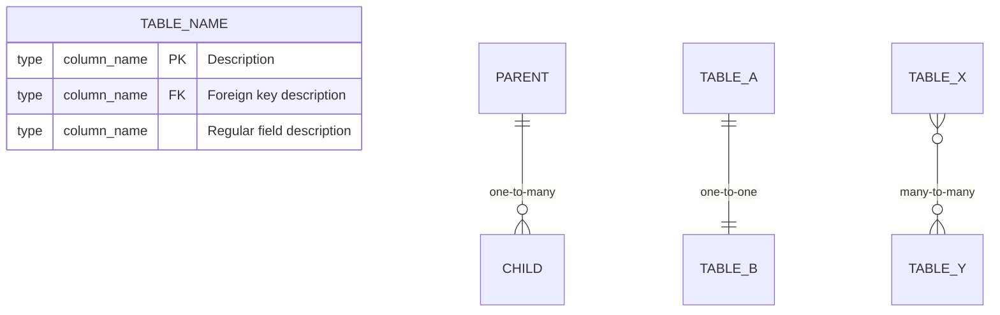

# Generate Data Model Documentation

## Overview

Create or update comprehensive data model documentation with entity relationship diagrams (ERD) covering databases, service models, and UI data structures. The output should be a single markdown file with Mermaid diagrams that renders in GitHub, Azure DevOps, and VS Code.

## Steps

1. **Discover Data Sources**
   - Identify all databases (SQL, NoSQL, vector stores)
   - Find backend schema definitions (Pydantic, SQLAlchemy, TypeORM, Prisma, etc.)
   - Locate frontend type definitions (TypeScript interfaces, PropTypes)
   - Check for API schemas (OpenAPI, GraphQL)

2. **Create System Overview Diagram**
   - High-level flowchart showing data flow between components
   - Include external data sources, application databases, and caches
   - Show relationships between backend services and frontend

3. **Document Database Schemas**
   - Create Mermaid ERD for each database/schema
   - Include all tables/collections with columns and types
   - Mark primary keys (PK), foreign keys (FK) in descriptions
   - Note unique constraints in field descriptions (Mermaid only supports PK/FK keywords)
   - Show relationships: one-to-one, one-to-many, many-to-many
   - Add table descriptions explaining purpose and key relationships

4. **Document Service Layer Models**
   - Map backend models to their database tables
   - Include code snippets showing model definitions
   - Document field mappings, aliases, and transformations
   - Note validation rules and constraints

5. **Document UI Data Models**
   - Map frontend types to backend API responses
   - Include TypeScript/JavaScript interface definitions
   - Document form data structures and state shapes
   - Show how UI models relate to service models

6. **Add Data Flow Diagrams**
   - Sequence diagrams for key user flows
   - State diagrams for entity lifecycles (if applicable)
   - Show how data moves through the system

## Output Format

```markdown
# [Project Name] Data Model

## Entity Relationship Diagrams

### System Overview
[Mermaid flowchart]

## 1. [Database/Schema Name]
[Description]
[Mermaid ERD]
[Table descriptions]

## 2. Backend Service Models
[Pydantic/ORM model definitions]

## 3. Frontend UI Models  
[TypeScript interface definitions]

## Data Flow Summary
[Sequence diagram]

## Version History
| Version | Date | Changes |
```

## Mermaid ERD Syntax Reference



**Constraint keywords**: Only `PK` and `FK` are valid. For unique constraints, note in the description string (e.g., `"User email (unique)"`).

## Checklist

### Discovery
- [ ] All databases identified
- [ ] Backend schemas located
- [ ] Frontend types located
- [ ] External data sources documented

### Diagrams
- [ ] System overview created
- [ ] ERD for each database/schema
- [ ] All relationships shown
- [ ] Mermaid syntax validated (no parse errors)

### Documentation
- [ ] Table/model descriptions included
- [ ] Field types and constraints documented
- [ ] Code examples for service models
- [ ] Code examples for UI models

### Quality
- [ ] Diagrams render correctly in target platforms
- [ ] Consistent naming conventions used
- [ ] Version history updated

