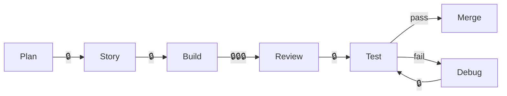

# Guidelines for AI-Assisted Software Development

**Purpose:** Practical guidance for developers, managers, and QA to engage effectively with AI-assisted coding tools using the ai-first-dis framework.

---

## Core Principles

### 1. AI Augments, Not Replaces

LLMs are **over-confident pair programmers**—lightning fast at looking things up and executing tedious tasks, but prone to mistakes. Don't anthropomorphize them; their failures are deeply inhuman (hallucinated APIs, subtly wrong logic).

| Mindset | ❌ Ineffective | ✅ Effective |
|---------|---------------|--------------|
| Expectations | "AI will implement this perfectly" | "AI accelerates my implementation" |
| Trust | Blind acceptance | Verify everything |
| Role | AI leads, human reviews | Human leads, AI executes |

### 2. Context is King

Most of the craft of getting good results comes down to **managing context**—what information the AI has access to when generating code.

| Context Source | What It Provides | How to Use |
|----------------|------------------|------------|
| `AGENTS.md` | Tech stack, architecture, coding patterns | Keep updated; reference existing code |
| Project Rules (`.cursor/rules/`) | Workflows, task-specific instructions | Invoke with `@rule-name` |
| Current files | Implementation details | Use `@file` to include relevant code |
| Conversation history | Accumulated decisions | Start fresh when stuck |

**Key insight:** When a conversation stops being useful, **reset context** by starting a new chat.

### 3. LLMs Amplify Existing Expertise

Your prompts leverage your experience. A senior developer's prompts produce better results than a junior's—not because of prompt tricks, but because domain knowledge shapes the request.

---

## Guidelines by Role

### For Developers

#### Planning Phase

| Practice | Action | Why |
|----------|--------|-----|
| **Start with research** | Use Ask Mode to explore options before coding | Avoids committing to wrong approaches |
| **Create implementation plans** | Write detailed plans in markdown before building | AI follows plans better than vague goals |
| **Break down complexity** | Divide features into small, testable increments | Each piece can be verified independently |
| **Maintain scope** | Keep a "later" section for ideas that emerge | Prevents feature creep |

```
# Good planning prompt
"What are the options for implementing real-time notifications? 
Consider WebSockets, SSE, and polling. Include trade-offs for each."

# Bad planning prompt  
"Add notifications to the app"
```

#### Building Phase

| Practice | Action | Why |
|----------|--------|-----|
| **Be authoritative** | Tell AI exactly what to do, with specifics | Reduces hallucinations and guessing |
| **Include constraints** | Specify framework, patterns, error handling | Aligns output with codebase |
| **Reference existing code** | Point to working examples with `@file` | AI follows patterns it can see |
| **Build iteratively** | Get simpler version working first, then enhance | Easier to catch issues early |

```
# Good implementation prompt
"Create a Python function with this signature:
async def fetch_user(user_id: str) -> User:
Use httpx for the HTTP call. Raise UserNotFoundError if 404.
Follow the pattern in @services/customer_service.py"

# Bad implementation prompt
"Write a function to get user data"
```

#### Testing & Verification

| Practice | Action | Why |
|----------|--------|-----|
| **Test every output** | Run the code AI writes before accepting | Catches obvious errors immediately |
| **Prioritize integration tests** | High-level tests catch regression from "helpful" changes | LLMs often modify unrelated code |
| **Watch for hallucinations** | Verify APIs, libraries, and methods exist | AI confidently invents things |
| **Use the browser tools** | Test UI changes visually, not just in code | Unit tests miss visual/interaction bugs |

#### Recovery Strategies

| Situation | Action |
|-----------|--------|
| AI "goes on a vision quest" | `git reset --hard HEAD` and start fresh |
| Multiple failed attempts | Reset to clean state, implement the correct solution cleanly |
| Conversation derailed | Start a new chat with fresh context |
| Stuck on same error | Try a different model or approach |

#### Version Control

| Practice | Action | Why |
|----------|--------|-----|
| **Commit frequently** | After each working increment | Creates restore points |
| **Start features clean** | `git checkout -b feature/name` from main | Isolates AI experiments |
| **Don't trust AI revert** | Use Git, not Cursor's undo | Git is the source of truth |
| **Review diffs carefully** | AI changes more than asked | Catches unintended modifications |

---

### For Managers

#### Setting Expectations

| Aspect | Guidance |
|--------|----------|
| **Productivity gains** | 20-50% faster for experienced devs; lower for juniors |
| **Quality impact** | Code reviews remain essential—AI introduces novel bugs |
| **Skill development** | AI accelerates learning but doesn't replace fundamentals |
| **Best use cases** | Boilerplate, tests, documentation, exploration, tedious refactoring |

#### Team Enablement

| Action | Purpose |
|--------|---------|
| **Provide context files** | Updated `AGENTS.md` with architecture decisions reduces hallucinations |
| **Define workflow rules** | Consistent processes across team via `.cursor/rules/` |
| **Allow experimentation** | Different approaches work for different developers |
| **Track model changes** | New model releases may require workflow adjustments |

#### Risk Management

| Risk | Mitigation |
|------|------------|
| Over-reliance on AI | Require tests and code review for all AI-generated code |
| Security vulnerabilities | Security hooks block sensitive data access; manual review for auth code |
| Knowledge silos | Documentation requirements; code must be human-readable |
| Inconsistent quality | Establish team conventions in `AGENTS.md` |

---

### For QA

#### Testing AI-Generated Code

| Focus Area | What to Check |
|------------|---------------|
| **Edge cases** | AI optimizes for happy path; probe boundaries |
| **Error handling** | Verify exceptions are caught, not swallowed |
| **Integration points** | AI may not understand system context |
| **Regression** | AI often "improves" unrelated code |

#### Verification Workflow

1. **Automated tests** — Run full test suite (`@tester` workflow)
2. **Acceptance criteria** — Verify against work item requirements
3. **Browser verification** — Manual UI testing for visual/interaction issues
4. **Security scan** — Check for credential exposure, injection vulnerabilities

#### Red Flags

| Signal | Action |
|--------|--------|
| "Refactored for clarity" in unrelated files | Request revert; AI scope creep |
| New dependencies added | Verify necessity and security |
| Overly complex solutions | Simpler alternatives often exist |
| Missing error handling | AI assumes happy path |

---

## Workflow Integration

### Cursor Modes

| Mode | Use Case | Invocation |
|------|----------|------------|
| **Ask** | Research, exploration, understanding | Default chat |
| **Plan** | Create implementation strategy | Click "Plan" button |
| **Build** | Execute implementation plan | Click "Build" from plan |
| **Agent** | Autonomous multi-step tasks | `@implement`, `@debugger`, etc. |

### Workflow Rules Quick Reference

| Rule | Purpose | When to Use |
|------|---------|-------------|
| `@planner` | Break down complex requirements | Starting new feature |
| `@story-creator` | Create Azure DevOps work items | Formalizing requirements |
| `@implement` | TDD implementation with PR | Building work items |
| `@reviewer` | Code review with PR feedback | Before merge |
| `@tester` | Verify acceptance criteria | QA sign-off |
| `@debugger` | Systematic issue investigation | Bug fixing |

### Human-in-the-Loop Checkpoints



> 🔒 = Human approval required

Critical checkpoints:
- **Plan approval** — Strategic decisions need human judgment
- **Git operations** — All push/commit requires confirmation
- **PR creation** — External resource creation needs approval
- **QA sign-off** — Human verifies acceptance criteria

---

## Effective Prompting

### Structure Your Requests

```markdown
# Good structure
1. Context: What exists, what you're working with
2. Task: Specific action required
3. Constraints: Framework, patterns, limitations
4. Output: Expected format or signature
5. Reference: Existing code to follow

# Example
"I'm adding a new endpoint to the FastAPI backend (@api/routes/).
Create a GET /users/{id}/permissions endpoint that:
- Returns list of permission strings
- Uses the existing auth dependency
- Follows the pattern in @api/routes/users.py
- Raises 404 if user not found"
```

### Prompt Anti-Patterns

| ❌ Avoid | ✅ Instead |
|---------|-----------|
| "Make it better" | "Add input validation for email format" |
| "Fix the bug" | "The TypeError on line 45 occurs when user is None—add null check" |
| "Implement authentication" | "Add JWT token validation middleware following @middleware/auth.py pattern" |
| "Clean up this code" | "Extract the validation logic into a separate function" |

### When to Start Fresh

- Conversation exceeds ~10 exchanges on same topic
- AI keeps making the same mistake
- Context has accumulated incorrect assumptions
- You've pivoted to a different approach

---

## Safety & Compliance

### Protected by Hooks

The framework includes security hooks that:
- **Block** catastrophic operations (`rm -rf /`, `DROP DATABASE`)
- **Require confirmation** for risky operations (force push, resource deletion)
- **Prevent** credential exposure (blocks reading `.env`, secrets)
- **Audit** all agent actions for compliance review

### Developer Responsibilities

| Responsibility | Action |
|----------------|--------|
| **Review all AI code** | Don't merge without understanding |
| **Test security paths** | AI may not consider attack vectors |
| **Protect secrets** | Never paste credentials in prompts |
| **Verify external calls** | AI may hallucinate APIs |

### Audit Trail

All AI-assisted actions are logged:
```bash
# View recent security events
tail -20 "$USERPROFILE/.cursor/logs/security-events.log"

# Check blocked operations
grep "\[BLOCKED\]" "$USERPROFILE/.cursor/logs/security-events.log"
```

---

## Quick Reference Card

### Developer Daily Workflow

```bash
# 1. Start clean
git checkout main && git pull && git checkout -b feature/task-name

# 2. Plan with AI
@planner implement [feature description]

# 3. Build incrementally  
@implement [work-item-id]

# 4. Test frequently
python tasks.py test-cov  # Backend
npm run test:coverage     # Frontend

# 5. Review before commit
# Use Cursor's Agent Review in Source Control panel

# 6. Ship with context
@reviewer [pr-id]
```

### Recovery Commands

| Situation | Command |
|-----------|---------|
| Undo all AI changes | `git reset --hard HEAD` |
| Undo last commit | `git reset --soft HEAD~1` |
| See what changed | `git diff` |
| Start fresh branch | `git checkout main && git checkout -b feature/retry` |

### Model Selection

| Task | Recommended Model |
|------|-------------------|
| Planning & architecture | Claude Sonnet 4.5 (thinking) |
| Fast implementation | Composer 1 / GPT-4o |
| Complex debugging | Claude Opus 4 |
| Code explanation | Any capable model |

---

## References

- [Simon Willison: How I Use LLMs to Help Me Write Code](https://simonwillison.net/2025/Mar/11/using-llms-for-code/)
- [Cursor Documentation](https://cursor.com/docs)
- Internal: [`knowledge/development/workflow.md`](workflow.md) — Detailed workflow documentation
- Internal: `cursor_context_management.md` <!-- UNVERIFIED: migrate if this source exists --> — Context engineering guide
- Internal: [`knowledge/security/cursor-hooks.md`](../security/cursor-hooks.md) — Security hook reference
