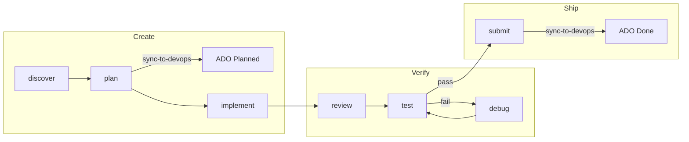

# Agentic Development Workflows

Two approaches to agentic development with Cursor: a lightweight **Solo Developer** workflow using Cursor's built-in tools, and a structured **Team Workflow** powered by the agent-factory skill collection.

---

## Solo Developer Workflow

Streamlined workflow for individual developers using Cursor's native features.

### Steps

1. **Research** — Use [Ask Mode](https://cursor.com/docs/agent/modes#ask) to explore options without code changes.
2. **Plan** — Use [Plan Mode](https://cursor.com/docs/agent/planning) with a thinking model to create an implementation plan.
3. **Build** — Execute the plan in [Agent Mode](https://cursor.com/docs/agent/overview).
4. **Test** — Write unit tests with `/write-unit-tests` if the agent didn't already.
5. **Review** — Use Cursor's [Agent Review](https://cursor.com/docs/agent/review) in Source Control (`Ctrl+Shift+G G`).
6. **Debug** — Use [Debug Mode](https://cursor.com/docs/agent/modes#debug) for tricky bugs.
7. **Ship** — Run `submit` to align specs, generate the PR description, and open the PR.
8. **Sync to DevOps** *(optional, teams using Azure DevOps)* — Run `sync to devops` so work items get full spec content in Description / Acceptance Criteria and status matches the repo (see Team Workflow below).

### When to Use

- Personal projects and prototypes
- Rapid iteration where process overhead isn't justified
- Learning and experimentation

---

## Team Workflow with Agent Factory

A structured SDLC with work item tracking, human-in-the-loop checkpoints, and full traceability through Azure DevOps. Powered by the skill collection at `.cursor/skills/agent-factory/`.


### SDLC Flow



### Skills


| Skill              | Purpose                                           | Typical Invocation                         |
| ------------------ | ------------------------------------------------- | ------------------------------------------ |
| **discover**       | Interview-driven requirements discovery           | "discover requirements for user dashboard" |
| **plan**           | Feature decomposition and implementation planning | "plan this feature"                        |
| **implement**      | TDD implementation with branch/commit/PR          | "implement F001"                           |
| **review**         | Code review for quality and correctness           | "review PR #123"                           |
| **test**           | Verify acceptance criteria (automated + human)    | "test work item #456"                      |
| **debug**          | Hypothesis-driven bug investigation               | "debug TypeError in auth module"           |
| **submit**         | Align specs, generate PR description, open PR     | "submit"                                   |
| **sync-to-devops** | Specs ↔ Azure DevOps (work items, full HTML from specs, PR links, status pull) | "sync to devops", "sync E001 to devops"   |
| **design**         | UI/UX design system and accessibility review      | "design review this component"             |
| **simplify**       | Post-implementation code simplification           | "simplify recent changes"                  |
| **council**        | Run decisions through 5 AI advisors               | "council this architecture choice"         |


### Planning Hierarchy

Two levels of planning provide enough context for implementation:

1. **Epic** (strategic) — Discovered via the `discover` skill. Produces a spec in `knowledge/specs/E001-*.md` with linked features.
2. **Feature** (tactical) — Planned via the `plan` skill or Cursor's Plan Mode. Produces an implementation plan with tasks.

User stories are optional. For most features, the Epic -> Feature decomposition gives Cursor enough context to plan and execute granular implementation directly.

### Specs as Knowledge Graph

Specs live in `knowledge/specs/` as markdown files linked with relative markdown links:

```
knowledge/specs/
  index.md                    # Entry point
  E001-user-dashboard.md      # Epic spec
  F001-dashboard-api.md       # Feature spec (links to E001)
  F002-dashboard-ui.md        # Feature spec (links to E001)
```

Link convention: `[E001-user-dashboard](E001-user-dashboard.md)`, `[F001-dashboard-api](F001-dashboard-api.md)`.

Use `sync-to-devops` at two points in the cycle:

1. **After `plan` approval** — Create or update Epics/Features in ADO, push spec text into **Description** and **Acceptance criteria** (HTML via `spec_to_ado_html.py` in `.cursor/skills/agent-factory/sync-to-devops/`). Work items in Active (or your process equivalent). This timestamps when work was committed to.
2. **After `submit`** *(PR opened or merged)* — Link the PR, set work items to Done, refresh fields from the latest `knowledge/specs/*.md` so non-repo stakeholders see the full spec in ADO.

The gap between the two syncs is measurable implementation lead time in ADO's work item history, without any manual tracking.

### Human-in-the-Loop Checkpoints

Any action that creates external resources or makes irreversible changes requires human approval:


| Category               | Examples                                          |
| ---------------------- | ------------------------------------------------- |
| **Discovery**          | Interview answers, spec approval                  |
| **Planning**           | Clarifying questions, plan approval               |
| **Git operations**     | Branch creation, commit, push                     |
| **External resources** | PR creation, DevOps work items                    |
| **QA decisions**       | Test pass/fail confirmation, merge/debug decision |


Human decisions should be documented using the `templates/decision-log.md` format and synced to DevOps as work item comments.

### Standardized Handoffs

Every skill produces a handoff document (see `templates/handoff.md`) that includes:

- Summary of what was accomplished
- Artifacts created/modified
- Key decisions with rationale
- Next steps for the receiving skill
- Open questions requiring human input

This standardized interface enables clean transitions between skills.

### Invoking Skills

```bash
# Start a new epic from a high-level idea
discover requirements for a real-time analytics dashboard

# Plan a specific feature
plan the API layer for F001-dashboard-api

# Implement a task
implement T2 from the plan

# Review a pull request
review PR #789

# Verify acceptance criteria
test work item #12345

# Debug a failing test
debug AC3 fails — allocation returns wrong results

# Submit PR (align specs, generate description, open PR)
submit

# Push / refresh specs in Azure DevOps (after plan and/or after submit)
sync to devops
sync knowledge/specs/E001-user-dashboard.md to devops

# Run a decision through the council
council this: should we use WebSockets or SSE for real-time updates?
```

### When to Use

- Team projects with formal work item tracking
- Enterprise environments requiring traceability
- Projects with QA sign-off requirements
- When you need audit trails for compliance

---

## Choosing Your Workflow


| Factor                | Solo                   | Team (Agent Factory)                             |
| --------------------- | ---------------------- | ------------------------------------------------ |
| **Setup**             | Zero config            | Requires Azure DevOps MCP + agent-factory skills |
| **Traceability**      | Git history only       | Full work item linkage via specs                 |
| **Human checkpoints** | Optional               | Built-in at each stage                           |
| **Best for**          | Speed, experimentation | Compliance, collaboration                        |


Mix approaches: use Solo for rapid prototyping, then formalize with Agent Factory when ready for production.

---

## Commands

Cursor [Commands](https://cursor.com/docs/agent/chat/commands) are reusable prompts saved as Markdown in `.cursor/commands/`. Type `/` in chat to invoke them.

### Locations

- **Project commands:** `.cursor/commands/` in your repository
- **Global commands:** `~/.cursor/commands/` on your machine

### Best Practices

- Be specific — describe expected outcome and acceptance criteria
- Provide context — reference project conventions
- Stay focused — one clear objective per command

---

## Hooks

Cursor [Hooks](https://cursor.com/docs/agent/hooks) are scripts that observe, block, or mutate agent behavior.

### Use Cases

- Block dangerous shell commands before execution
- Redact secrets before agent reads sensitive content
- Apply safety guardrails around MCP tool usage

### Setup

1. Add hook scripts to `~/.cursor/hooks/`
2. Map to agent actions in `~/.cursor/hooks.json`
3. Make executable and restart Cursor

