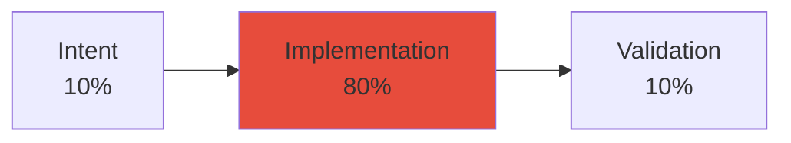
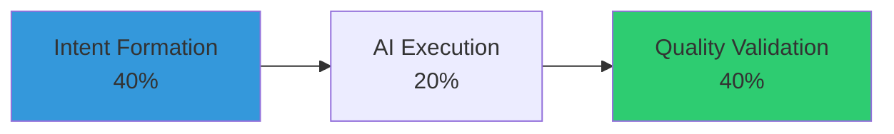
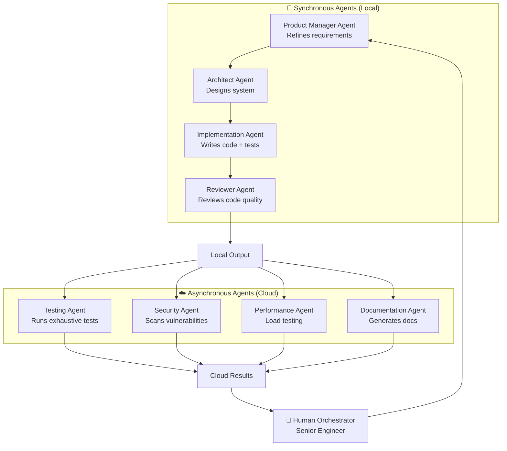
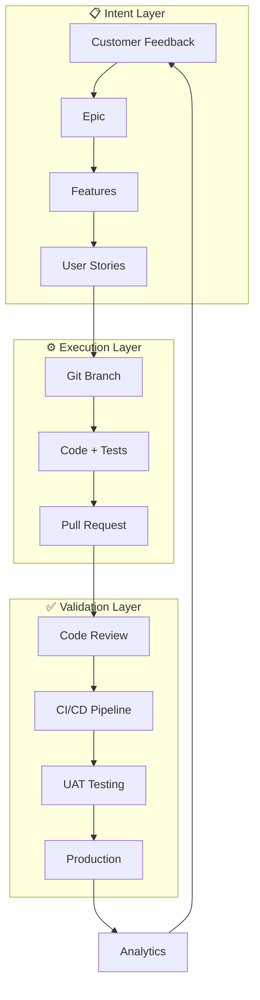

# The Future of Product Development in 2026

## Executive Summary

Software development is undergoing a fundamental transformation. The "middle" of development—the time-intensive work of translating requirements into code—is rapidly shrinking as AI agents take over implementation. This shift repositions Product Development departments to focus on **intent formation** at the start and **quality validation** at the end, with AI-orchestrated execution in between.

For large corporate organizations, this means:
- **10x software output** with the same team size
- Product Management and Design become the primary bottleneck (positively)
- Code review and UAT testing become new capacity constraints
- AI-native applications introduce non-deterministic outputs requiring new QA approaches
- Developer roles evolve from "coders" to "orchestrators" of agent teams

---

## The Disappearing Middle

### Traditional Software Development (2020-2023)



**Characteristics:**
- Most effort spent in IDE writing, debugging, refactoring code
- Weeks or months from specification to working software
- Developer productivity measured in lines of code or features shipped
- Limited by typing speed and individual cognitive capacity

### AI-Augmented Development (2024-2025)


**Characteristics:**
- AI copilots assist with code completion and suggestions
- Developers still write most code but faster
- Development cycles reduced by 30-50%
- IDE remains primary workspace

### AI-Orchestrated Development (2026+)



**Characteristics:**
- AI agents generate working code from goals, context, and constraints
- Developers orchestrate multi-agent workflows (sync + async)
- Development cycles measured in minutes/hours, not weeks
- IDE becomes a "code viewer" for review and validation
- **The middle has collapsed**

---

## The New Software Development Equation


### What Matters More

#### 1. Intent Formation (Product & Design)

**The Critical Question:** *What actually needs to be built?*

This becomes the primary value-add activity:
- Understanding customer problems through interviews, feedback analysis
- Shaping work so agents can act on it effectively
- Defining constraints, tradeoffs, and acceptance criteria
- Creating context-rich specifications that reduce ambiguity

**Key Activities:**
- Customer research and feedback triage
- Problem framing and opportunity sizing
- Writing clear, structured requirements
- Defining success metrics and acceptance criteria
- Creating design artifacts (wireframes, prototypes, user flows)

**Why It Matters:**
- Agents operate directly on this input
- Poor intent = wasted agent cycles producing wrong solutions
- Clarity here determines execution quality

#### 2. Quality Validation (Review & Testing)

**The Critical Question:** *Does the output actually meet the intent?*

As agents produce more code with less supervision:
- Code review becomes a **capacity bottleneck**
- UAT testing must scale to match 10x output
- Non-deterministic AI-native apps require new testing approaches

**Key Activities:**
- Architectural review (is the design sound?)
- Security review (are vulnerabilities introduced?)
- Functional testing (does it work as specified?)
- UAT with real users (does it solve the actual problem?)
- Performance and reliability validation

**Why It Matters:**
- High-volume output amplifies the cost of defects
- Trust in AI-generated code must be earned through validation
- Quality gates prevent technical debt accumulation

### What Matters Less

- **Typing speed** — agents generate code orders of magnitude faster
- **Deep IDE mastery** — less time spent in the editor
- **Syntax memorization** — agents handle implementation details
- **Manual debugging** — agents can fix issues autonomously

---

## Multi-Agent Orchestration: The New Development Model

### Agent Team Architecture

Modern product development departments will orchestrate **teams of specialized agents**:



### Synchronous Agents (Interactive)

**Characteristics:**
- Run locally during development session
- Immediate feedback loop with human
- Handle critical path decisions
- Require human approval at key checkpoints

**Examples:**
- `@epic-planner` — Interviews PM, creates specifications
- `@planner` — Analyzes features, proposes implementation plan
- `@implement` — Generates code, writes tests, creates PR
- `@reviewer` — Reviews code, suggests improvements

**Typical Session (20-60 minutes):**
```
1. Human: @epic-planner create user dashboard
2. Agent: [asks 5 rounds of clarifying questions]
3. Human: [answers, providing context]
4. Agent: [generates spec document]
5. Human: [approves spec]
6. Agent: [creates Epic + Features in Azure DevOps]
7. Human: @implement Feature #12345
8. Agent: [generates code, tests, creates PR]
9. Human: [reviews, approves]
```

### Asynchronous Agents (Background)

**Characteristics:**
- Run in cloud infrastructure 24/7
- Long-running or resource-intensive tasks
- No real-time human interaction required
- Report results via notifications/dashboards

**Examples:**
- Exhaustive test suite execution (1000s of test cases)
- Security vulnerability scanning across codebase
- Performance benchmarking under various loads
- Documentation generation from code + comments
- Migration of legacy code to modern frameworks
- Technical debt analysis and refactoring suggestions

**Typical Workflow:**
```
1. PR created by sync agent → triggers async agents
2. Testing Agent: Runs full regression suite (2 hours)
3. Security Agent: Scans for vulnerabilities (30 mins)
4. Performance Agent: Executes load tests (1 hour)
5. Documentation Agent: Updates API docs (15 mins)
6. Results posted to PR → Human reviews summary
```

### Orchestration Challenges

**1. Context Propagation**
- How do agents share context across sync/async boundaries?
- Solution: Structured work items (Azure DevOps) + rich descriptions

**2. Coordination**
- How do multiple agents avoid conflicts?
- Solution: Clear ownership (one agent per file/module at a time)

**3. Error Handling**
- What happens when an agent fails or produces incorrect output?
- Solution: Human checkpoints before external resource creation

**4. Cost Management**
- Cloud agents consume compute resources 24/7
- Solution: Priority queues, budget limits, selective triggering

---

## The New Bottlenecks

As AI removes the coding bottleneck, new constraints emerge:

### 1. Product Management & Design (Intentional Bottleneck)

**Why it's a bottleneck:**
- Human creativity and judgment cannot be automated
- Customer empathy requires real conversations
- Strategic tradeoffs need business context

**Impact:**
- PM/Design ratio increases (1 PM per 15 engineers → 1 PM per 30 agents)
- More time spent on research, less on writing specs
- Design becomes continuous discovery, not waterfall

**How to scale:**
- ✅ Hire more PMs and designers (positive investment)
- ✅ Use AI to synthesize customer feedback at scale
- ✅ Create feedback loops directly from customers to PMs
- ✅ Invest in user research infrastructure

### 2. Code Review (Capacity Constraint)

**Why it's a bottleneck:**
- 10x code output requires 10x review capacity
- AI-generated code still needs human validation
- Architectural decisions require senior judgment

**Impact:**
- Senior engineers spend 60-80% time reviewing, not coding
- Review queues become longest wait time in SDLC
- Need for specialized "AI Code Reviewers"

**How to scale:**
- ⚠️ AI-assisted review (agents summarize changes, flag risks)
- ⚠️ Tiered review (critical vs. routine changes)
- ⚠️ Automated quality gates (linting, security scans before human review)
- ⚠️ Increase senior engineer headcount
- ⚠️ Upskill mid-level engineers in architectural review

### 3. UAT Testing (Capacity Constraint)

**Why it's a bottleneck:**
- Human judgment needed for UX quality
- AI-native apps produce non-deterministic outputs
- Automated tests can't catch all edge cases

**Impact:**
- QA teams overwhelmed with 10x feature output
- Longer time-to-production despite faster development
- Risk of quality degradation if rushed

**How to scale:**
- ⚠️ Shift-left testing (more unit tests, fewer manual tests)
- ⚠️ AI-powered test case generation
- ⚠️ Crowdsourced testing platforms
- ⚠️ Increase QA headcount
- ⚠️ Beta programs with real users for AI features

---

## AI-Native Applications: New Quality Challenges

### Deterministic vs. Non-Deterministic Software

**Traditional Software (Deterministic):**
```python
def calculate_tax(income: float) -> float:
    return income * 0.20  # Always same output for same input
```
✅ Easy to test: assert `calculate_tax(1000) == 200`

**AI-Native Software (Non-Deterministic):**
```python
def generate_report_summary(data: DataFrame) -> str:
    # LLM generates summary — varies each time
    return llm.complete(prompt=f"Summarize: {data}")
```
❌ Hard to test: output varies, how to validate quality?

### Testing AI-Native Features

**New QA Approaches Required:**

1. **Semantic Testing** — Verify meaning, not exact output
   ```python
   summary = generate_report_summary(data)
   assert "revenue increased" in summary.lower()
   assert len(summary.split()) < 200  # brevity check
   ```

2. **LLM-as-Judge** — Use AI to evaluate AI output
   ```python
   evaluator_llm.score(
       question="Is this summary accurate and concise?",
       context=data,
       output=summary
   )
   assert score > 0.8
   ```

3. **Human Evaluation** — Sample-based review by experts
   - Review 10% of AI outputs manually
   - Flag patterns in poor outputs
   - Retrain or adjust prompts

4. **Regression Datasets** — "Golden" examples
   - Curate set of exemplar inputs/outputs
   - Test new model versions against golden set
   - Measure quality degradation over time

**Implications:**
- QA teams need ML/AI expertise
- Testing takes longer (more subjective)
- Versioning and rollback become critical
- A/B testing becomes standard practice

---

## Organizational Transformation

### New Roles & Responsibilities

#### 1. AI Orchestrator (formerly Senior Engineer)

**Responsibilities:**
- Direct teams of sync + async agents
- Define task breakdowns for agent execution
- Review and validate agent outputs
- Handle escalations when agents fail
- Optimize agent workflows for efficiency

**Skills:**
- Prompt engineering (clear, structured instructions)
- Multi-agent coordination
- Architectural thinking (less hands-on coding)
- System design and tradeoff analysis
- Code review at scale

**Daily Work:**
```
8:00  — Review overnight async agent results
9:00  — @epic-planner session with PM (new feature)
10:30 — @implement 3 user stories (agent generates code)
11:00 — Review 5 PRs from agents
14:00 — @debugger session (agent found regression)
15:00 — Architecture review with team
16:00 — Optimize agent prompts based on learnings
```

#### 2. Product Manager (Intent Specialist)

**Responsibilities:**
- Primary requirements gathering and synthesis
- Customer research and feedback triage
- Define acceptance criteria with precision
- Provide context for agent execution
- Validate that outputs solve real problems

**Skills:**
- Deep customer empathy
- Structured writing (specs, user stories)
- Tradeoff analysis
- Metrics definition
- Stakeholder communication

**Daily Work:**
```
8:00  — Analyze customer feedback (AI-synthesized insights)
9:00  — @epic-planner session with AI Orchestrator
11:00 — Refine user stories with acceptance criteria
14:00 — UAT session with real users
15:30 — Prioritization meeting with leadership
16:30 — Review analytics dashboards
```

#### 3. QA Engineer (Validation Specialist)

**Responsibilities:**
- Design test strategies for AI-native features
- Execute UAT for non-deterministic outputs
- Build automated test suites (with agent help)
- Evaluate semantic correctness of AI outputs
- Regression testing at scale

**Skills:**
- AI/ML testing methodologies
- LLM-as-judge evaluation frameworks
- Exploratory testing
- Test automation (with AI assistance)
- Quality metrics definition

**Daily Work:**
```
8:00  — Review test results from async testing agents
9:00  — Design test cases for new AI feature
10:30 — Execute UAT with sample users
13:00 — Validate 20 PRs (AI-assisted review)
15:00 — Analyze quality trends across sprints
16:00 — Update regression test datasets
```

#### 4. Designer (Experience Architect)

**Responsibilities:**
- Design user experiences for AI-native features
- Create prototypes and wireframes
- Define interaction patterns
- Validate UX with real users
- Ensure consistency across AI-generated UIs

**Skills:**
- UX research and validation
- Prototyping (Figma, etc.)
- Design systems thinking
- Accessibility expertise
- Collaboration with AI tools

**Daily Work:**
```
8:00  — User research synthesis (AI-assisted)
9:30  — Design review with PM
11:00 — Create wireframes for new feature
14:00 — Usability testing session
15:30 — Update design system components
16:30 — Review AI-generated UI code for consistency
```

---

## Coordination Layer: The Critical Infrastructure

### Why Structure Matters for AI Agents

From the research and Linear's perspective:

> "Structure in tools works for humans and agents the same way: it reduces the ambiguity of what is expected or what capabilities exist."

**Key Requirements:**
1. **Context-Rich Work Items** — Azure DevOps with detailed descriptions
2. **Structured Workflows** — Clear stages, checkpoints, ownership
3. **Traceability** — Link from customer feedback → Epic → Feature → User Story → PR → Deployment
4. **Intent Capture** — Why decisions were made, what constraints apply

### Azure DevOps as Coordination Layer



**Benefits for AI Agents:**
- Clear starting point (work item with full context)
- Expected outcomes defined (acceptance criteria)
- Structured artifacts (PRs, test results)
- Feedback loops (bugs, analytics back to work items)

---

## Conclusion: The New Craft

As the "middle" of software development disappears, **the craft evolves**:

- **From typing code** → **to shaping intent**
- **From debugging** → **to validating outcomes**
- **From solo coding** → **to orchestrating agent teams**
- **From implementation details** → **to architectural thinking**

### The Winners in 2026

Organizations that will thrive:
1. ✅ **Invest in Product & Design** — Build strong intent formation
2. ✅ **Embrace AI Orchestration** — Adopt multi-agent workflows
3. ✅ **Scale Review & QA** — Address the new bottlenecks
4. ✅ **Structure Everything** — Create context-rich work items
5. ✅ **Measure Outcomes, Not Activity** — Focus on business value

### The Losers in 2026

Organizations that will struggle:
1. ❌ **Cling to Manual Coding** — Refuse to adopt AI workflows
2. ❌ **Underinvest in PMs** — Weak intent = wasted agent cycles
3. ❌ **Skip Code Review** — Ship AI-generated code without validation
4. ❌ **Ignore Non-Deterministic QA** — Fail to test AI-native features
5. ❌ **Treat Agents as Tools** — Miss the orchestration opportunity

### The Question for Leadership

> "When the middle disappears, what becomes more in focus is the work of forming the right intent and making sure the outcome actually meets it."

**The strategic imperative:** Build organizational muscle in intent formation (Product & Design) and outcome validation (Review & QA), while enabling engineers to orchestrate AI agents at scale.

The companies that figure this out will deliver **10x more software** with the **same headcount**. The companies that don't will be left behind.

---

*Document Version: 1.0*
*Last Updated: January 2026*
*Audience: Product Development Leadership, Engineering Managers, CTOs*

